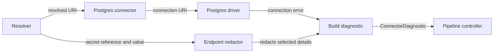

# Typed secrets for connectors

Design proposal for [cloud#2214](https://github.com/feldera/cloud/issues/2214).

## Problem

A user may have permission to read a pipeline's logs without having access
to its passwords.
When a Postgres input connection failed, the connector reported the full URI,
including the password. The error appeared in the pipeline log, deployment
status, monitor events, and support bundle. The worker reported the failure
during startup, before the connector could use its error callback.
[Incident report](https://github.com/feldera/cloud/issues/2136) · [Postgres input worker](../../crates/connectors/src/integrated/postgres/input.rs)

Today, connector authors choose what to include in each message. The pipeline
searches outgoing text for known secrets, but Rust allows connector code to
format both credentials and raw driver errors as ordinary text.

## Proposal

This is an information flow problem. The driver needs the password. The user
needs to know why the connection failed. Two new types let the Rust compiler
check what connector code can print or report.

| Type | Crate | Purpose |
|---|---|---|
| `Secret` | `feldera-types` | Protects a credential from accidental printing. |
| `ConnectorDiagnostic` | `feldera-adapterlib` | Connectors use this type for every error they report to the controller. Its constructors restrict what the message can contain. |

An *endpoint* is one configured input or output connector in a pipeline.
Its *redactor* replaces known secrets in a message with their references or
a redaction marker. The diagram shows how the Postgres driver receives the
URI and how the controller learns that the connection failed.

The process-wide registry continues to filter library logs, panic messages,
and HTTP error responses.

## Holding a credential with `Secret`

| Aspect | Behavior |
|---|---|
| `Display` | Rust rejects `format!("{token}")` because `Secret` has no `Display` implementation. |
| `Debug` | Prints `[REDACTED]`. |
| Reading the value | Call `expose_secret()` to configure the driver or register the value for redaction. |
| JSON | Serde reads and writes both literals and secret references as strings. |
| REST API | The pipeline manager's OpenAPI schema (`openapi.json`) describes these fields as strings. |
| Rust API | Changing a field from `String` to `Secret` breaks source compatibility for callers that set or read it through the published `feldera-types` crate. |

Start with fields that hold a single credential, such as an S2 authentication
token or a Postgres TLS private key.

Other settings contain credentials alongside ordinary configuration.

| Value | Handling |
|---|---|
| Postgres connection string | `Secret` can wrap the whole string or the password alone after parsing. The driver can still quote the password in an error, so register both its raw and unescaped forms. [libpq password extraction](../../crates/feldera-types/src/sensitive.rs) |
| Kafka, object store, and Iceberg options | Each connector uses its list of known credential keys to identify sensitive values. |
| Avro registry settings | Read credentials from the raw JSON before parsing the settings. An invalid configuration can still contain a valid password. [Avro settings](../../crates/feldera-types/src/format/avro.rs) |

A password written directly in SQL is part of the program before any connector
code runs. SQL compiler messages can quote it, and support bundles include
connector settings as supplied even when the user excludes source code. A
secret reference keeps the password out of the SQL. INT-31152 tracks the
separate decision about removing inline credentials from bundles.
[Secret references in diagnostics](../../docs.feldera.com/docs/connectors/secret-references.md#diagnostics) · [Bundle policy](https://github.com/feldera/feldera/pull/7788)

## Resolving a secret

The pipeline creates a `SecretRedactor` each time it opens an endpoint,
including when it resumes. [SecretRedactor](../../crates/feldera-types/src/secret_redaction.rs) · [Resolver](../../crates/feldera-types/src/secret_resolver.rs)

1. When the resolver reads a secret reference such as `${secret:kubernetes:pg/uri}`,
   it registers the reference and its value in both the endpoint redactor and
   the process-wide registry. Any string in the transport or format settings
   can hold a reference, including a Kafka topic or a custom header.
2. Before validating the resolved settings or creating a client, the pipeline
   also registers declared credentials in both places. This covers passwords
   supplied inline or through environment variables. Other environment values
   are ordinary configuration. If a password also came from a secret
   reference, messages show that reference.
3. The transport, format, and worker code share the resolved settings and
   the endpoint redactor. The stored configuration retains the original
   references.

If resolution fails, the error identifies the field or reference and explains
why. If two endpoints read the same password through different references,
each reports its own reference.

## Reporting an error with `ConnectorDiagnostic`

`ConnectorDiagnostic` has private fields. Its constructors accept four kinds
of input.

| Constructor | Input | Example |
|---|---|---|
| Fixed message | A static string | "replication slot is missing" |
| Specific failure | A count, a known field name, or an error code | Attempt count, SQLSTATE |
| Configuration value | An endpoint setting that the constructor passes through the endpoint redactor | Topic, table, file path, S3 key |
| Driver error | A wrapped driver error | Failed Postgres connection |

A connector cannot pass an arbitrary `String`, `impl Display`, format
arguments, or an `anyhow::Error` directly to the reporting API. Omit a
configuration value if reporting it could reveal a credential.

Handle driver errors at the call that returns them. For example, the Postgres
connector checks SQLSTATE to decide whether to retry. Extend its
`LibraryError` wrapper to apply the endpoint redactor when it scrubs the
details of an error, including nested causes. If the connector cannot
interpret a driver's message, report which operation failed, any stable error
code, and what the user can do next. [LibraryError](https://github.com/feldera/feldera/pull/7857)

The diagnostic owns the finished message. Its debug output, serialized form,
and error chain expose only that message, even after the endpoint closes.
The controller knows the endpoint name and receives the fatal flag and tag
separately. It stores the message, timestamp, tag, and sequence number in
`adapter_stats::ConnectorError`. [Statistics types](../../crates/feldera-types/src/adapter_stats.rs)

### What the Rust compiler can miss

| Mistake | Why it compiles | Protection |
|---|---|---|
| Logging the result of `expose_secret()` | The call returns the credential as a string the driver can use to authenticate. | Keep the call next to the code that needs the value. |
| Formatting a raw driver error | A driver can quote a rejected option's value. Clippy flags explicit uses of the raw error type, but Rust can infer the type in a log call. | Test the connector's diagnostic before the global filter runs. |
| Serializing configuration for a log message | `serde_json::to_string(&config)` uses `Serialize`, which writes the real password even when `Debug` prints `[REDACTED]`. | Build startup summaries and validation errors from fields such as the endpoint name and transport type. |

The redactor skips values shorter than eight bytes and can miss a value the
driver has transformed. A connector therefore selects the details it can
safely report before passing its message to the redactor.

## Where messages go

| Path | Handling |
|---|---|
| Startup | Return a diagnostic if transport or format setup, input `open()`, output `connect()`, or worker initialization fails. |
| Reads and writes | Use diagnostics for asynchronous callbacks, synchronous `OutputProbe` failures, and `InputConsumer::check_flush`. Include connectors in the separate `feldera-iceberg` crate. |
| Health | During a retry, Delta input publishes a health description that appears in a successful `/stats` response. Build it from the diagnostic. Redact descriptions from older callers before storing them. |
| Parsing and encoding | Convert an Avro schema registry error before caching it or adding it to a `ParseError`. Redact stored parse and encode errors. Keep the existing policy for record data. |
| Checkpoints | Redact messages before truncating and storing them. On restore, redact them again before applying length and count limits. After a secret rotates, the redactor may no longer recognize the old value. |
| Manager and support bundles | The manager scrubs credentials from older runtime diagnostics and bundle collections without resolving connector secrets. |

[Adapter callbacks](../../crates/adapterlib/src/transport.rs) · [Controller](../../crates/connectors/src/controller.rs) · [Delta retries](../../crates/connectors/src/integrated/delta_table/input.rs) · [Avro lookup](../../crates/connectors/src/format/avro/input.rs) · [Error storage and restore](../../crates/connectors/src/controller/stats.rs)

## Rollout and acceptance tests

1. **Introduce `Secret`.**

   - For each converted field, read and write existing JSON. Verify that both
     a literal value and a secret reference survive the round trip.
   - Check that `Debug` hides the value and that direct display fails to compile.
   - Regenerate the OpenAPI schema and verify that the diff is empty.
   - List the changed Rust fields in the changelog.

2. **Convert Postgres input first.** Add typed callbacks alongside the current
   API. Their defaults forward the finished message to existing consumers.

   - Inspect a real connection failure before global filtering. The report
     should name the endpoint and explain the failure without exposing the URI
     or password.
   - Verify that the connector makes the same retry decisions for each SQLSTATE.
   - Follow the error through the log, `/status`, `deployment_error`, stored
     events, and the exported bundle. Check both the message and its structured
     details for credentials. [Status test](../../crates/connectors/src/server.rs) · [Bundle test](../../crates/pipeline-manager/src/api/endpoints/pipeline_interaction/support_bundle.rs)

3. **Convert one connector or driver group per PR.** Use `Secret` for its
   credential fields and diagnostics for its error and health reports. In each
   PR, test a driver failure that echoes a credential and inspect the message
   before global filtering. The tests across all groups should cover the
   following cases. [Remaining drivers](https://github.com/feldera/cloud/issues/2213)

   - A secret reference in an ordinary field, a short credential, and an
     escaped libpq password.
   - Malformed Avro settings and a schema registry lookup failure.
   - A synchronous write failure and a retry reported in `/stats`.
   - Two endpoints with different references to the same value. Each should
     report its own reference.

4. **Remove the old reporting API once all callers have migrated.**

   - Remove the forwarding methods and build every connector group.
   - Document the change to the public adapter traits.
   - Add compile-fail tests for raw errors and preformatted strings.
   - Restore an old checkpoint containing a current secret. Verify that the
     endpoint status and the next checkpoint show the reference. Check that
     restore preserves error indices and tags and applies the same truncation
     limits.

## Open questions

- Does `Secret` need its own crate? Its first users are the configuration
  types in `feldera-types`.
- Would it help callers if `ConnectorDiagnostic` indicated whether to retry?
  The proposal leaves retry decisions to the connector that handles the error.
- Which failures need their own constructor? Migrating the connectors will
  show which cases the configuration-value constructor covers.
